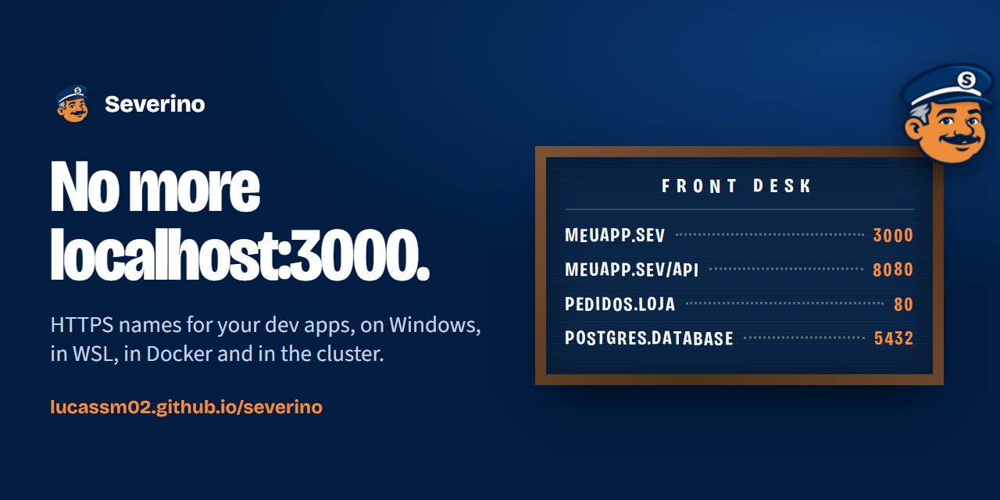
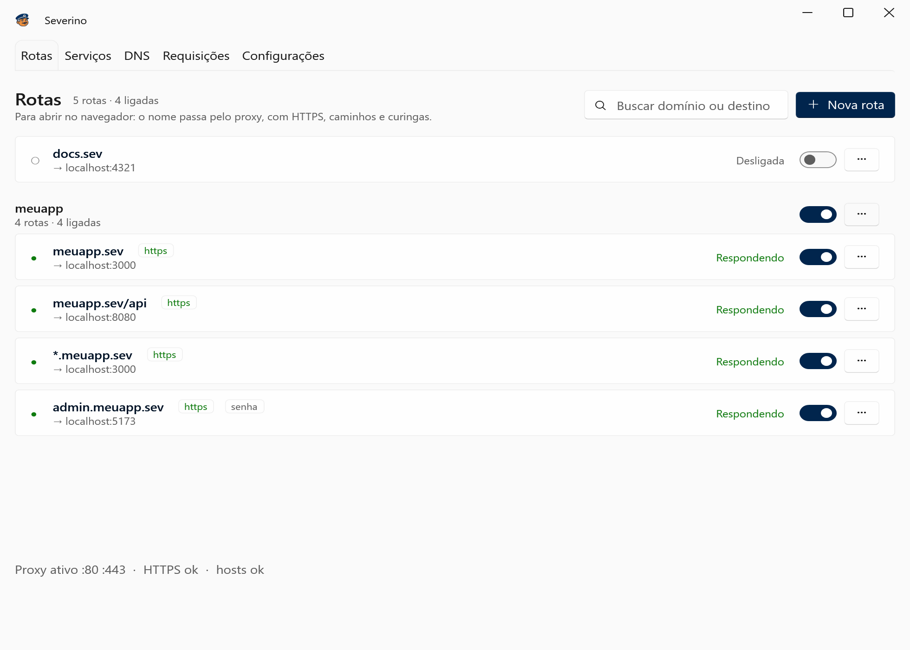

# Severino

**English** | [Português](docs/pt-BR/README.md)

[](https://github.com/lucassm02/severino/actions/workflows/ci.yml)



**The doorman for your dev apps on Windows.** Every app gets a name, like `meuapp.sev`, with real HTTPS, whether it runs on Windows, in WSL, in a container or in a Kubernetes cluster. Severino takes care of the hosts file, the reverse proxy and the certificates.

[Website](https://lucassm02.github.io/severino/) · [Download](https://github.com/lucassm02/severino/releases/latest) · [Changelog](CHANGELOG.md) · [MIT](LICENSE) license

> Severino is a common name in Brazil and, by tradition, the name of the doorman in Brazilian jokes. Here he keeps the building's board: which name goes to which port.

## What it does

- **Routes**, for the browser: `meuapp.sev → localhost:3000`, with HTTPS from a local certificate authority that only signs your domains. Also by path (`meuapp.sev/api`), by wildcard (`*.meuapp.sev`) and in groups that switch on and off together.
- **Services**, for databases, queues and the rest: `postgres.database:5432` reaches the cluster over any protocol. Imports from Kubernetes (NodePort, managed port-forward, Ingress) and from Docker, on Windows or in WSL, and fixes the ports on its own when they change.
- **DNS**, for other machines: `banco.interno → 10.0.0.8`, kept with the app closed. Also shows the hosts lines other programs wrote, without touching them unless you ask.
- **WSL**: the distros you choose call the same names.
- **Requests**: a log of what went through the proxy and the services, kept in memory only.
- **PowerShell**: a module that talks to the running app (`New-SeverinoRoute`, `Set-SeverinoDns`, `Disable-SeverinoRoute -Group`).
- **English and Portuguese**: the app follows the Windows language, or the one you pick in Settings.



## Install

Get the installer from the [latest release](https://github.com/lucassm02/severino/releases/latest). It is for Windows 10 and 11, 64-bit, and brings the .NET runtime along.

The installer is not code-signed yet: if SmartScreen warns, click "More info" and then "Run anyway". On first launch, a wizard checks port 80, the helper service and the system proxy.

When a new version comes out, the app tells you and updates in one click, checking the installer's SHA-256. To find out about new versions it asks the GitHub API once a day, sending only its own version. You can turn that off in **Settings › About**.

To remove everything Severino put into Windows, use **Settings › Clean up everything** or the uninstaller.

## How it works

| Part | Runs as | Does |
| --- | --- | --- |
| `Severino.App` | you | WPF window, YARP/Kestrel proxy on `127.0.0.1` and `::1`, service forwarding, local CA in `CurrentUser\Root`. |
| `Severino.Helper` | Windows service, elevated | The only part with admin rights: writes the hosts blocks, answers wildcards from a DNS server on `127.53.0.1` and keeps the NRPT rules. Validates everything it receives again. |
| `Severino.Contracts` | | Name validation and the named pipe protocol, shared by both. |

The routes and services block only takes loopback addresses. The DNS block takes loopback and private networks; a public IP or a wildcard suffix only goes in after an administrator confirmation (UAC).

The full design, with its decisions and what is left out, is in [docs/pt-BR/planejamento.md](docs/pt-BR/planejamento.md), in Portuguese. Each phase's spec is in [docs/pt-BR/specs/](docs/pt-BR/specs/), and the manual test guides in [docs/pt-BR/testes/](docs/pt-BR/testes/).

## Develop

You need Windows and the [.NET 10 SDK](https://dotnet.microsoft.com/download).

```powershell
dotnet build
dotnet test
dotnet run --project src/Severino.App
```

The app runs as a regular user but needs the helper service to write the hosts file. During development, install it from an elevated terminal:

```powershell
./scripts/dev-helper.ps1 install
```

Other scripts:

- `scripts/build-installer.ps1`: publishes the app and the helper and builds the installer with Inno Setup.
- `scripts/build-social.ps1`: renders the social media images from `assets/branding/social/banner.html`.
- `node scripts/render-motion.mjs`: renders the intro video (`assets/branding/motion/intro.html`, 30 s) to MP4, frame by frame, with headless Edge and ffmpeg.
- `node scripts/check-links.mjs`: checks the relative links of every Markdown file.
- `dotnet run scripts/build-icons.cs`: builds the app icons from the artwork in `assets/branding/`.

The website lives in `site/`. To preview it: `python -m http.server 8765 --directory site`. A push that changes `site/` publishes it to GitHub Pages.

### Translations

The app's texts live in `Strings.resx` (English, the fallback) and `Strings.pt-BR.resx` (Portuguese), one pair per project that shows text: `Severino.App`, `Severino.Core`, `Severino.Contracts` and `Severino.Proxy`. A test fails when a key is missing from one of them or when their placeholders differ.

### Conventions

- Commits follow [Conventional Commits](https://www.conventionalcommits.org/), in English.
- Package versions live in `Directory.Packages.props`; `Directory.Build.props` treats warnings as errors.
- Every relevant change goes under `[Unreleased]` in both changelogs: [this one](CHANGELOG.md), in English, and the [Portuguese one](docs/pt-BR/CHANGELOG.md). To release, move what is under `[Unreleased]` to a `[x.y.z] - date` section with the number the **Release** workflow (Actions) will produce, and run the workflow: the release notes come from that section of the English changelog.

## License

[MIT](LICENSE). Use, change and share it freely.
